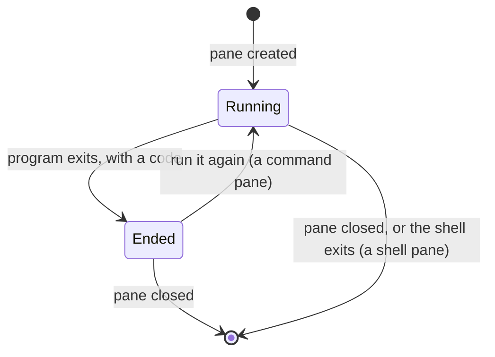
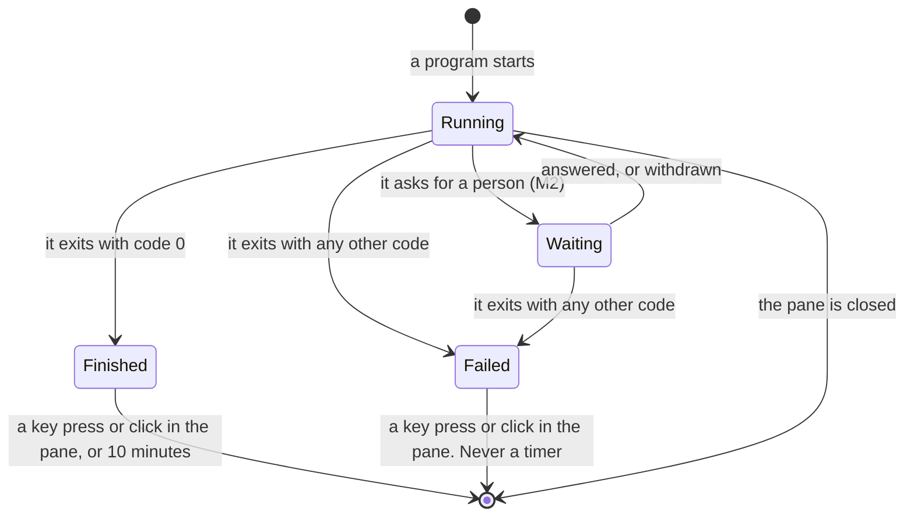

- Intent: TASK-1, "A terminal like Rex, built in Rust and GPUI and extendable through Python".
- One of steg's specs. doc-1 is the overview: it has the vocabulary, the release table and the list of specs. Requirement numbers are steg-wide and never reused.
- Rests on: decision-5 (focus, clients and windows), decision-6 (terminal size), decision-7 (status).
- Status: draft, written 2026-11-15. R8 to R12, R78 and R85 to R91 were moved here from the server spec without rewording. R93 to R97 are new: they write down rules that until now were only in the design artifact or implied by a decision. R109 (the colour a sixth session takes) and R100 were added on 2026-11-15, when Bruk set the smallest pane and confirmed R95 and R96.

## Scope

The things steg is made of and the rules between them, said once, so that the server, the wire protocol, the CLI and the app all mean the same thing by the same word. It says what is true in every release and through every interface. It does not say how anything is drawn, sent or typed, and it does not list fields: those come from the API description (decision-1).

This is the specification of the kernel, the library that holds state and has no socket and no window (doc-1, section 7).

## The things

| Thing | What it is | Belongs to |
|---|---|---|
| Server | One per host. Owns everything below | A host |
| Session | A named, long-lived workspace | One server |
| Tab | An ordered page within a session | One session |
| Pane | A region of a tab, running one program in a terminal | One tab |
| Program | What runs in a pane: a shell, or a command | One pane |
| Status | What steg knows about a pane's program at this moment | One pane |
| Client | One connection to a server | One server |

A **window** is not in the domain. It is the app's: a thing that is drawn, holding one client for each server it uses. Nothing in the tree above can tell you about a window, and no server knows what one shows (R87).

```
server
  session            has a current tab
    tab              has a current pane, a layout, and at most one pane filling it
      pane           has one program and at most one status
  client             views zero or more sessions
```

## Requirements

### Structure

- R93 (M1). Every pane belongs to exactly one tab, every tab to exactly one session, and
  every session to exactly one server. A session's identity includes its server: two
  servers may each have a session with the same label.
- R94 (M1). A tab has at least one pane and a session has at least one tab. Closing a
  tab's last pane closes the tab, and closing a session's last tab ends the session.
- R8 (M1). A session holds ordered tabs. A tab holds panes arranged in nested horizontal
  and vertical splits.
- R9 (M1). Panes can be split, closed, focused by direction, resized, swapped, moved to
  another tab, and zoomed to fill the tab and back.
- R10 (M1). Sessions, tabs, and panes can carry labels. Each is addressable by full ID,
  label, position, or an ID suffix of four or more characters. An ambiguous target is an
  error, never a guess.
- R11 (M3). A pane can float above a tab's splits, be moved and resized, and be minimised
  and restored.
- R12 (M1). The pane model allows kinds other than terminals, even though v1 ships only
  the terminal kind.
- R78 (M1). Where a split comes from, where a closed pane's space goes, the smallest a
  pane may be, and what happens when the window is resized follow the design artifact (doc-10).
- R95 (M1). A tab's layout is a tree. A leaf is a pane. Every other node is a split, with
  a direction, a ratio between 0 and 1, and exactly two children. A split divides one
  pane and nothing else, and closing a pane gives its space to the other child of its
  split. What is held is the ratio, never a size, so every client shares the proportions.
- R96 (M1). At most one pane fills its tab at a time. Filling changes nothing in the
  layout tree, and the other panes keep running.
- R109 (M1). A new session takes the first of the five colours that no session is using. When all five are in use it takes the first colour again, and so on round.
- R100 (M1). No split or resize leaves a terminal pane smaller than 20 columns by 4 rows,
  judged by the terminal's size at the time. A split that would is refused, and a resize
  stops at that floor. A window growing smaller refuses and closes nothing: a pane may
  go under the floor that way, and its terminal is cropped. The app keeps a floor of its
  own in pixels as well (doc-10).

### Focus, clients and size

- R85 (M1). Focus is a path down a server's tree, held by that server: each session has a
  current tab, and each tab has a current pane. Focusing a pane makes its tab the current
  tab of its session as well. There is no focus across servers.
- R86 (M1). A client is one connection to one server. Every client can learn of every
  session on that server and of changes to them. A client views zero or more sessions,
  which is what brings it their terminals' contents; the protocol sets no limit on how
  many.
- R87 (M1). A window belongs to the app, not to any server. It holds one client for each
  server it uses and shows one session at a time. Which session a window shows is held by
  the app. In M1 there is one server, and the app views exactly the session each window
  shows.
- R88 (M1). Focusing a pane or a tab never changes which sessions a client views or which
  session a window shows. Only the person at that window, or a command addressed to that
  client, does.
- R89 (M1). Two windows showing the same session show the same current tab, the same
  current pane and the same pane layout. Per-window focus is not provided.
- R90 (M1). A pane is in view when it is in the current tab of a session that a window is
  showing. That is the app's judgement from R85 and R87; a server does not track what is
  visible. R50's ring and bar, and R51's notifications, are decided by the app on this
  basis.
- R91 (M1). A terminal has one size. When more than one client views a session, each
  terminal in it takes the size it would have in the client most recently active in that
  session, meaning the last one to send input to it or be resized. Every other client
  draws the terminal at that size, anchored at its top left: with empty ground beyond it
  where that client's pane is larger, and cropped where it is smaller. Text is never
  rescaled. The pane layout's proportions are shared by all clients (R89); only the count
  of rows and columns follows the latest. This holds for two windows on one machine in M1
  and for clients on different machines in M3 alike.

### A pane's program

- R97 (M1). A pane runs one program, which is running and then has ended with an exit
  code. A pane started with a command stays when the command ends, keeps what it printed,
  and can run the same command again in the same directory. A pane started as a plain
  shell closes when the shell exits.



### Status

The requirements for status are in doc-11 (R49 to R52, R82 to R84). This is the shape they describe, so that it can be read in one place.

- A pane has at most one status at a time; a new report replaces the last.
- A tab's status is the most pressing among its panes: waiting, then failed, then the bell, then finished, then running.
- A session has none.



The bell (M2) is an event, not a stage: it can arrive in any state, lasts until a key press or click in the pane or 30 seconds, and then the pane returns to what it had.

## Open questions

- [ ] Whether a bell replaces the status it arrives over or sits beside it. This spec says the pane returns to what it had; nothing decided says so.
- [ ] Floating panes (R11, M3) do not fit a tree of splits. Their shape in the layout is not designed.

## Out of scope

- Anything about pixels, drawing or motion (doc-10 and the design artifact).
- What travels between a server and a client (doc-14), and the names of commands (doc-2).
- The fields of each thing. They come from the API description.
- How the software is divided into running parts. That is the architecture model, to be written in LikeC4 as a task in the breakdown.
